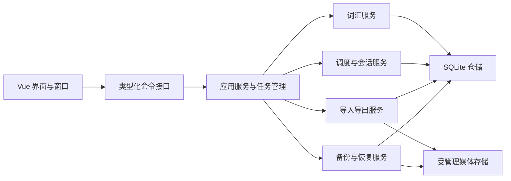

# 02 架构与数据模型

> 当前正式存储为 `data/main.sqlite3`，不使用版本子目录；旧版数据已按要求删除，原 `v3/` 新版数据移回根目录，不提供软件内迁入。实际词条表由 `src-tauri/src/storage/migrations/003_wordbook.sql` 建立：写法、假名、释义必填，音调仅存数字，不包含标签、媒体、音调来源和备注格式。以下旧模型字段及升级设想不代表当前正式库。

## 1. 技术决策与模块边界

采用 Tauri 2 + Rust + Vue 3/TypeScript + SQLite。M0 已建立工程和独立验证模块，依赖由锁文件固定；Windows 上已验证 WebView、FTS5 和 FSRS 基础兼容性，三平台构建与全部验收尚未完成。M1-A 已建立 `storage/` 正式数据库模块、两版迁移、迁移前快照和串行事务服务；业务编辑、调度和完整备份恢复仍为后续阶段规格，不能将 schema 存在视为这些功能已经实现。



前端负责视图、焦点、表单和本地展示状态；后端负责持久化、校验、算法、文件路径与事务。前端不能直接执行 SQL、解析任意磁盘文件或自行计算正式到期时间。

应用服务不直接依赖具体 Vue 组件。调度器是可替换接口，输入旧卡片、时间、评分和固定参数，输出新状态；时钟可注入以便测试。

## 2. 命令与任务契约

以下为建议接口族，初始化时生成或校验对应 TypeScript/Rust 类型，禁止以任意字符串 SQL 作为 IPC：

| 接口族 | 代表命令 | 关键约束 |
| --- | --- | --- |
| 查询 | `list_words(query, cursor, limit)`、`get_word(id)` | limit 默认 100，上限 500；返回稳定游标和查询标识 |
| 编辑 | `create_word`、`update_word(id, revision, patch)` | 使用 revision 乐观锁，冲突时返回最新记录供重新编辑 |
| 批量 | `apply_tags(ids, revision_policy)`、`move_memberships` | 明确 ID 范围，返回实际变更数 |
| 导入 | `inspect_import`、`validate_import`、`commit_import`、`cancel_task` | 返回任务 ID；提交绑定预检摘要与文件摘要 |
| 学习 | `start_session`、`reveal_card`、`rate_card(event_id, revision, rating)`、`undo_review` | 每张卡所有窗口共用后端状态 |
| 数据 | `create_backup`、`inspect_backup`、`restore_backup` | 后端生成和检查文件选择能力，前端不传任意 SQL/目录遍历路径 |

统一错误结构：`code`、可展示的 `message`、可选字段错误、`retryable`、`task_id`；内部堆栈仅写脱敏日志。建议错误码：`VALIDATION_FAILED`、`REVISION_CONFLICT`、`FILE_UNSUPPORTED`、`IMPORT_CONFLICT`、`DB_BUSY`、`DISK_FULL`、`BACKUP_INVALID`、`SCHEMA_TOO_NEW`。

任务进度事件包含任务 ID、阶段、已完成单位、总量（未知可空）和是否可取消。前端断开或关闭窗口不能隐式取消已经进入最终提交的任务。

## 3. 持久化约定

- 实体 ID 使用 UUID 字符串；外部来源 ID 不直接冒充本地实体 ID。
- 所有持久时间为 UTC Unix 毫秒整数。SQLite `INTEGER` 与 IPC 的安全整数范围须校验；日期字符串只用于输入输出和展示。
- 文本原值经去首尾空白及 NFC 后保存；检索归一化结果另存派生字段，不能覆盖日文原文。
- 所有可编辑聚合持有 `revision`、`created_at`、`updated_at`。批量导入也走同样的校验规则。
- 金额、概率、天数等不能混用单位；调度器内部秒/天由适配层显式转换。
- 外键始终开启；可空字段表示未知，空字符串和 0 不代替未知。

## 4. 逻辑关系模型

本节定义字段契约；正式 SQL 迁移由 M1 实现并经约束测试验证。

| 表 | 核心字段 | 关系与规则 |
| --- | --- | --- |
| `libraries` | `id, name, description, archived, revision, created_at, updated_at` | 名称非唯一；删除仅级联成员关系 |
| `words` | `id, kanji?, kana, jlpt?, note, note_format, search_text, revision, created_at, updated_at` | kana 必填；jlpt 为 N1—N5 或空；note_format 为 plain/markdown |
| `senses` | `id, word_id, position, meaning` | meaning 必填；同词下 position 唯一；至少一个有效义项由事务校验 |
| `word_pos` | `word_id, pos_code` | 联合唯一；词性字典稳定编码，未知输入需映射或保存原始备注 |
| `examples` | `id, word_id, sense_id?, position, jp, cn?, accepted_answers_json?` | sense_id 若非空须属于同一 word；填空答案 M4 使用 |
| `pitch_accents` | `id, word_id, mora_count, downstep, source?` | `0 <= downstep <= mora_count`；mora_count 为正整数；无记录即未知 |
| `library_words` | `library_id, word_id, added_at` | 联合主键，一词可属多个词库 |
| `tags` / `word_tags` | `id, name` / `word_id, tag_id` | 标签名归一化后唯一；关联联合唯一 |
| `media` | `id, sha256, relative_path, mime, size, status` | SHA-256 唯一；路径由程序生成；status 为 staged/ready |
| `word_media` | `word_id, media_id, role, position` | role 为 pronunciation/image；不把二进制存进 words |
| `source_links` | `source_namespace, external_id, word_id, last_import_hash` | namespace + external_id 唯一；记录外部身份到本地实体映射 |
| `cards` | `id, word_id, card_type, state, due_at?, last_review_at?, stability?, difficulty?, reps, lapses, learning_step?, suspended, buried_until?, scheduler_version, parameter_set_id, revision` | word_id + card_type 唯一；MVP 仅 recognition；new 卡 due_at 可空 |
| `review_events` | `id, card_id, session_id, event_type, rating?, reviewed_at, study_day, elapsed_ms, before_json, after_json, scheduler_version, parameter_set_id, reverted_at?` | ID 为幂等键；event_type 为 rating/reset；保留变更前后快照 |
| `sessions` | `id, scope_json, started_at, finished_at?, status` | 状态 active/completed/abandoned；重启不自动恢复显示中的旧答案 |
| `scheduler_parameters` | `id, algorithm, version, parameters_json, desired_retention, created_at` | 不变快照；更改创建新行 |
| `import_jobs` | `id, file_hash, format, status, summary_json, created_at, committed_at?` | 记录摘要与结果，不保存原始完整文件 |
| `settings` | `key, value_json, revision` | 仅允许已知键，进行类型和范围校验 |
| `schema_migrations` | `version, checksum, applied_at` | 迁移脚本校验和不可事后修改 |

学习日按活动会话固定的时区和日切设置写入 `study_day`，修改设置不会重分类既有统计。重置事件不计为评分；撤销事件通过 `reverted_at` 排除统计。

为支撑 04 的队列与配额，正式迁移还需包括以下字段：`cards.introduced_at?` 记录当前学习周期首次评分时间，`cards.eligible_since` 记录首次进入有效学习范围的时间；`review_events.is_new_introduction` 标记该评分是否引入新词；`sessions.timezone`、`sessions.day_start_hour` 固定会话日规则。每日新词额度按未撤销的引入事件、学习日和 word_id 去重计算；重置不删除当日历史额度。卡片创建时绑定当时默认参数集，尚未评分时 stability/difficulty 可空。

M4 为例句补充 `cloze_start`、`cloze_end` 和 `answer_match_options_json`：范围使用原文 NFC 归一化后的 Unicode 标量索引、左闭右开，不使用 UTF-8 字节或 JavaScript UTF-16 下标；编辑例句原文时必须重新校验挖空范围。JSON/Protobuf 交换协议同阶段显式升级以携带这些字段，不修改已冻结的 V1 含义。

当前词性编码为 `noun`、`godan_verb`、`ichidan_verb`、`suru_verb`、`kuru_verb`、`i_adjective`、`na_adjective`、`adverb`、`particle`、`expression`、`other`，另有 `intransitive`（自动词）与 `transitive`（他动词）两个动词附加属性。一个词可保留多个适用词性；自／他属性最多一个，且须伴随至少一个动词活用类别；不确定时不录入属性。通过追加迁移扩展 `word_pos` 约束，旧库旧词条保持原状。

音调按拍而非字符计数；拗音与促音/长音需按日语规则处理。自动计算仅作提示，无法确认时允许用户手动修正或不录入音调。

## 5. 索引与检索

必须有成员关系双向索引、`words(updated_at, id)`、`cards(suspended, due_at, id)`、`review_events(card_id, reviewed_at)`、`review_events(study_day, reverted_at)`、外部身份唯一索引和标签关联索引。

日文和中文子串搜索不能假定 SQLite 默认分词器足够。M0 验证 FTS5 trigram 对三字符以上查询的适用性；不足三个 Unicode 字符时使用范围受控的归一化子串检索。索引候选必须再核对实际包含关系，确保与 01 的查询语义一致。若所选构建无法支持目标性能，先调整 SQLite 构建或检索方案并记录决策，不静默把日文搜索降为按空格分词。

列表默认按 `(updated_at DESC, id)` 游标分页；其他排序使用对应值和 ID 的复合游标。跨页编辑后重新查询并尽量保持选中项，不把变化中的结果集视为固定快照。

## 6. 数据目录与媒体一致性

```text
<操作系统应用数据目录>/NyakoWordbook/
  data/main.sqlite3
  media/<sha256 前两位>/<sha256>.<受控扩展名>
  backups/
  staging/<任务 UUID>/
  logs/
```

不能把 SQLite 的 `-wal`、`-shm` 当成可随意删除的临时文件。数据库打开期间不通过普通文件复制制作备份。

媒体导入先复制并校验到 staging，再移动到内容寻址位置，最后提交数据库引用；取消或失败可能留下无引用文件，但不能产生指向缺失文件的已提交引用。启动维护任务只清理可确认无活动任务引用且超过宽限期的暂存文件；媒体垃圾回收需在备份/导出任务结束后执行，建议保留无引用媒体 7 天。

## 7. 并发、事务与恢复

写入通过单一服务队列串行执行。SQLite 设置 `foreign_keys=ON`、`journal_mode=WAL`、`busy_timeout=5000`；`synchronous` 建议 FULL，最终取舍以掉电恢复与性能验证为依据。WAL 改善读写并发，不消除所有锁冲突。

- 词条及其义项/例句/关联作为一个事务保存。
- 卡片新状态与 review_event 同一事务提交；唯一事件 ID 防止重试造成重复评分。
- 导入先在 staging 完成解析和校验，最终合并在一个事务中完成。大任务会占用写队列，需提前暂停新写操作并显示状态。
- SQLite 事务可回滚；文件系统操作采用暂存、校验、原子重命名和孤儿回收补足，不能声称两者具有同一事务。

按操作系统用户和数据目录实施应用单实例锁；第二次启动将打开文件请求交给主实例。数据库约束与事务仍需独立正确，不能依赖单实例锁替代数据一致性。

## 8. 迁移、备份与恢复

启动发现更高 schema 版本时阻止写入并提示升级。迁移前通过 SQLite 在线备份 API 生成一致数据库副本，确认成功后再迁移；失败保留备份并停止打开业务界面。禁止自动降级数据库。

完整备份建议使用独立 `.nyakobak` ZIP 容器，包含 `manifest.json`、一致性数据库快照及清单引用的媒体。清单记录备份格式版本、schema 版本、应用版本、创建时间、各文件长度与 SHA-256；不包含机器绝对路径。仅支持方法受控的 ZIP 条目，解包限制沿用 03 的路径与体积规则。

备份期间阻止业务写入与媒体回收，读取可继续；快照完成后只复制快照引用的媒体。备份先写目标同目录临时文件，校验后原子替换；失败不覆盖原备份。

恢复时先检验清单、散列、SQLite 完整性和外键、媒体引用及 schema 兼容性，在 staging 打开验证。验证通过后进入维护模式、创建当前数据备份、关闭连接，再切换目录。保留恢复日志与旧目录，重启成功后才清理；切换中断下次启动须能选择完整旧版本回退。完整恢复覆盖全部本地数据，不与当前库合并。
