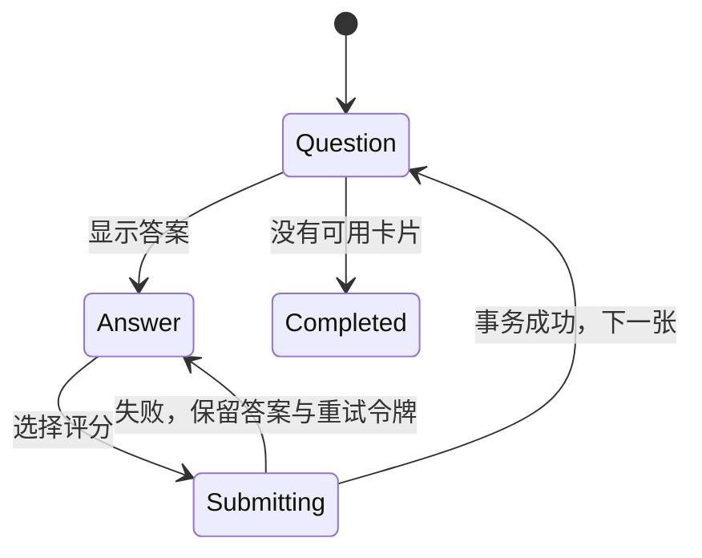

# 04 学习与复习调度

## 1. 调度基线

采用固定版本的 FSRS 作为长期调度器，目标记忆保持率默认 0.90，可配置范围建议 0.80—0.97。具体算法版本、Rust 库、默认权重、许可证和参考实现由 M0 验证后锁定；不能以“基于艾宾浩斯”代替可复现算法定义，也不能在实现中混用 SM-2 的 ease/level 语义。

MVP 不训练个性化权重，不在后台自动更换算法。每次评分记录算法版本、参数集、输入与输出快照。修改保持率创建新参数集，仅影响后续评分，默认不批量重排已有到期时间。将来提供全量重算时必须单独预览与确认。

`stability` 使用天为单位，`difficulty` 使用所选 FSRS 版本的定义范围；范围由适配层验证。用户界面优先显示下次到期和状态，不把内部难度误称为“熟练等级”。

## 2. 卡片与状态

MVP 每个词条只有一个 `recognition` 卡片，跨词库共享。卡片状态和用户暂停状态分开；暂停不清除历史。

| 状态 | 含义 | 进入队列条件 |
| --- | --- | --- |
| `new` | 尚无有效评分 | 学习范围内，且今日新词额度未用完 |
| `learning` | 初次学习短期步骤中 | due_at 已到且未暂停/埋藏 |
| `review` | 已进入长期复习 | due_at 已到且未暂停/埋藏 |
| `relearning` | 遗忘后的短期巩固 | due_at 已到且未暂停/埋藏 |

`buried_until` 表示临时埋藏至指定 UTC 时刻；默认使用下一个学习日边界。暂停持续到用户恢复；恢复后保留原到期时间，过期卡立即成为到期卡。归档词库仅改变会话范围，不把共享卡片暂停。

## 3. 短期步骤与 FSRS 适配

建议首次学习步骤为 1 分钟、10 分钟；遗忘后的巩固步骤为 10 分钟。短期步骤是产品层规则，需在 M0 验证与选定 FSRS 实现的状态输入输出兼容。每次正式评分均调用同一适配器更新记忆状态；短期 due_at 可以覆盖 FSRS 建议间隔，但不能伪造已经经过的时间。

| 原状态 | Again（1） | Hard（2） | Good（3） | Easy（4） |
| --- | --- | --- | --- | --- |
| new | learning 第一步，1 分钟后 | learning 第一步，5 分钟后 | learning 第二步，10 分钟后 | 直接 review，使用 FSRS 长期间隔 |
| learning | 回到第一步，1 分钟后 | 保留步骤；第一步 5 分钟，第二步 10 分钟 | 前进一步；已在最后一步则进入 review | 直接进入 review |
| review | relearning，10 分钟后；lapses +1 | review，FSRS 间隔 | review，FSRS 间隔 | review，FSRS 间隔 |
| relearning | 保留 relearning，10 分钟后 | 保留 relearning，15 分钟后 | 进入 review，FSRS 间隔 | 进入 review，FSRS 间隔 |

进入长期 review 时建议最小间隔 1 天、最大 36,500 天；实际间隔、舍入、同日重复评分和零经过时间的合法性必须由锁定版本适配器用参考用例验证。MVP 禁用随机抖动，确保同输入可复现。若参考实现不支持上述短期策略，应在 M0 修改并冻结本表，不能在开发时各处单独计算。

`reps` 为有效 rating 事件数；`lapses` 仅统计从 review 评分 Again 的次数。撤销恢复原计数；重置通过 reset 事件清除当前卡片状态，但保留历史事件。

## 4. 学习日、时区与限额

- 数据使用 UTC 毫秒，展示和每日额度按用户学习时区计算；初次默认系统 IANA 时区，持久保存，不因系统时区临时变化自动迁移。
- 学习日默认当地 04:00 切换；设置接受 00:00—06:00 整点。学习日为该时区和日切规则对应的本地日期。
- 夏令时不存在的日切时刻采用当天第一个有效时刻；重复时刻采用较早实例。下一个学习日须按日历计算，不能直接加 24 小时。
- 默认每日新词上限 20，允许 0—200。额度全应用共享；新词首次成功评分消耗一个额度，不按短期重复次数收费。
- 每日复习不设置硬性上限，到期卡不得因“今日目标已完成”而隐藏；界面可给建议目标和剩余数量。
- 新词首次评分撤销后恢复额度；重置后同一天再次引入同一词条不重复占新词额度。
- 修改学习时区/日切点从下一次新会话生效，不改写历史事件的 study_day；活动会话固定自己的日规则，界面提示生效时间。

系统时钟变化明显（建议超过 5 分钟）时提醒用户。持久化 review 时间不得早于该卡上次有效评分时间；出现倒退时暂停正式评分并让用户修正时间/稍后重试，不静默生成负间隔。

## 5. 会话和队列

开始会话时用户选择全部启用词库、单一词库或筛选范围。会话固定范围条件与学习日设置，但每次取卡重新校验当前成员关系、暂停状态和 due_at；词条被删除或移出范围时跳过并提示。

优先级依次为：到期 learning/relearning、到期 review、新词。同级按 due_at 升序、稳定 ID 排序；新词按首次加入学习范围时间和 ID。多个所选词库命中同词时按 card_id 去重。MVP 不提前调出尚未到期的长期卡。

- 队列不是一次性加载全部卡片，只预取有限批次。
- 若只剩未来短期卡，显示最近到期倒计时，允许离开；不强制空等，不提前记为已复习。
- 新词额度耗尽仍须完成已到期学习卡。
- 退出不回滚已经提交的评分；重启后从持久化卡片状态建立新会话。未评分卡不计作已学。
- 多窗口共享一个活动正式会话和当前卡片令牌；主窗与小窗不能各自消耗同一张卡。独立练习使用不同会话类型。

## 6. 单张卡片状态机与幂等

Question 显示写法/假名和可选音频，不通过隐藏可访问文本泄露释义。Answer 展示全部义项、例句、音调和备注，并显示四个按钮对应的预计下次时间。预计值来自同一后端适配器，实际评分仍以提交时刻为准；跨时间边界时允许轻微变化。

评分请求包含唯一 event_id、会话 ID、当前卡令牌、card revision、rating 和响应时间。提交期间禁用评分按钮和快捷键。后端在同一事务校验卡片版本、写 review_events、更新 cards；重复 event_id 返回同一结果。不同 event_id 但旧令牌/旧 revision 返回冲突，不能再评分一次。

只有后端确认成功才能显示下一张；磁盘满或数据库忙时保留答案和评分意图供重试。IPC 超时后查询 event_id 结果，不能把未知提交状态当失败并生成新事件 ID。

响应时间用单调时钟累计前台活跃时间，窗口失焦暂停，单次计入上限 120 秒；响应时间用于统计，不改变 FSRS 输入的真实经过时间。

## 7. 撤销、跳过、埋藏与重置

- **撤销**：仅支持本次活动会话最后一条未撤销评分。后续没有其他卡片评分，且目标卡 revision 与该事件 after 快照一致时，事务恢复 before 快照，事件标为 reverted，并恢复额度；再次提交撤销请求幂等返回结果。
- 撤销后重新展示该卡的 Question，之后重新评分生成新 event_id；不从数据库物理删除原事件。
- 有后续评分、编辑调度状态、重置或会话结束时不可撤销，按钮显示原因。普通词汇内容编辑不改变 card revision，不因此阻断撤销。
- **跳过**：本次会话不再出现，不写 rating；下次会话仍可出现。
- **埋藏到明天**：持久化 buried_until 为下个学习日边界；不写 rating，不移动 due_at。
- **暂停**：从所有正式队列排除；支持批量恢复。
- **重置**：确认后记录 reset 事件并恢复 new 状态；清空当前记忆参数与 due_at，不抹掉历史统计。重置不可用评分撤销恢复。

## 8. 练习模式（M4）

### 四选一

每题一个词和四个中文选项，正确答案来自选定义项。干扰项来自当前范围其他词的义项，优先同词性和近等级。剔除与正确答案归一化后相同的文本、重复选项和本词其他义项。无法得到三个不同干扰项时提示扩大范围或跳过，不生成少于四项却仍标作四选一的题目。

按 1—4 或点击选择后显示结果；选中后不可修改，Enter/Space 下一题。选项顺序每题打乱并保存在题目快照中，可复查。正确/错误、作答时长记录在独立练习结果中；正式调度不变。练习持久化表在 M4 迁移中加入，不向 review_events 填入伪造 rating。

### 例句填空

例句必须具有人工确认的挖空范围和 `accepted_answers`；保存时验证范围在原文边界上且不拆开 Unicode 字符。答案可配置如 `働きます`，不依赖内置变形生成器。没有合法范围和答案时不可进入填空队列。

比较规则为 NFC、去首尾空白；假名等价、标点忽略等需按题目显式配置并展示。输入法 composition 期间 Enter 不提交；展示答案后才可下一题。结果只影响练习统计。

## 9. 必须覆盖的调度验收

固定参数和虚拟时钟下，同一输入得到相同状态；四状态四评分覆盖表中所有转换；包含零间隔、跨日、夏令时、时区设置变更、时钟倒退与最大间隔。重复请求、IPC 响应丢失、撤销重试、退出重启和双窗口竞争均不能产生额外评分。
